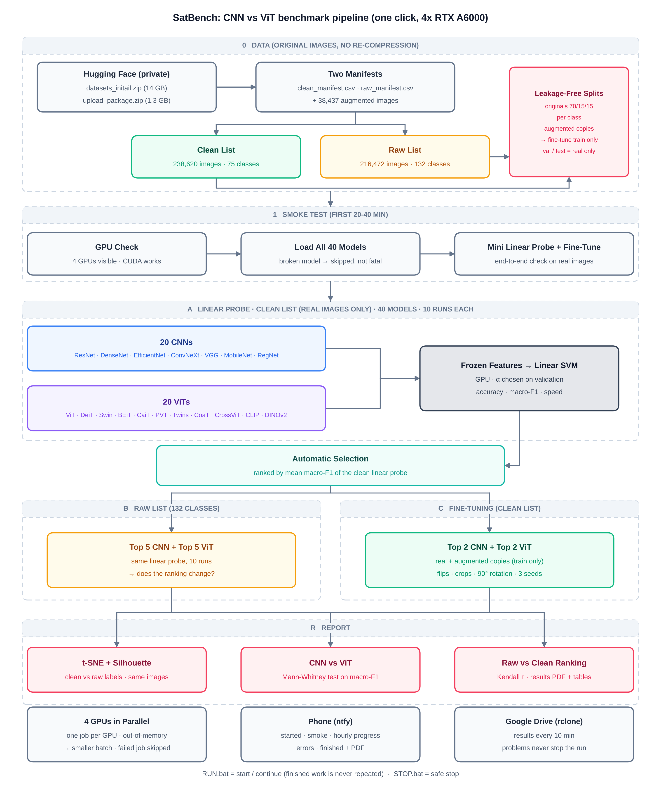

# RS75-Bench

**A human-verified 75-class remote-sensing scene benchmark built from 15 pooled public datasets,
with a label audit and an evaluation of 20 CNNs and 20 Vision Transformers.**

Bilal Jan, Hafeez Anwar, Aman Iqbal — National University of Computer and Emerging Sciences (FAST), Peshawar

Paper: *[title and link will be added after publication]*

---

Pooling public scene-classification datasets by their folder names is a common way to get more training data, but it
silently merges each dataset's naming choices: synonyms (`grassland` / `meadow`), parent and sub-type labels
(`residential` / `dense_residential`), broad catch-all folders, and the same picture under different labels in
different datasets. This repository contains everything needed to reproduce our audit and benchmark:

* image lists, manifests and fixed train/validation/test splits for a **clean 75-class list** and the **raw
  132-class list** built from 15 public datasets;
* a one-click benchmark that evaluates **40 ImageNet-, CLIP- and DINOv2-pretrained backbones** with a linear probe,
  re-tests the best ones on the raw labels, and fine-tunes the top models;
* all results (tables, statistics, per-class scores, confusion matrices, t-SNE maps).



## Highlights

| | |
|---|---|
| Source datasets | 15 public scene datasets |
| Clean list | 200,183 real images, 75 classes (+ 41,252 augmented copies for fine-tuning only) |
| Raw list | 216,472 images, 132 classes (original folder names) |
| Best linear probe | ViT-L/16: macro-F1 **0.929** (93.8% accuracy) |
| Best fine-tuned model | ViT-L/16: macro-F1 **0.972** (97.7% accuracy) |
| CNN vs ViT (40 models) | mean macro-F1 0.876 vs 0.866, not significant (p = 0.76) |
| Label consistency | clean labels fit the feature space better than raw labels for **40/40** models |

## Quick start

```bash
git clone https://github.com/amaniqbal-ai/RS75-Bench.git
cd RS75-Bench
pip install -r requirements.txt
```

| I want to… | Read |
|---|---|
| install the software | [docs/1_installation.md](docs/1_installation.md) |
| rebuild the datasets from the public sources | [docs/2_dataset.md](docs/2_dataset.md) |
| run the benchmark (Windows one-click or command line) | [docs/3_running.md](docs/3_running.md) |
| understand the result files and all numbers | [docs/4_results.md](docs/4_results.md) |
| fix a problem | [docs/5_troubleshooting.md](docs/5_troubleshooting.md) |

## Main results

**Linear probe, clean list** (frozen features + linear SVM, 10 random splits, real images only) — top 10 of 40:

| # | Model | Family | macro-F1 (mean ± SD) | Accuracy | Params (M) | Input (px) | GPU img/s |
|---:|---|---|---|---|---:|---:|---:|
| 1 | `vit_large_patch16_224.augreg_in21k_ft_in1k` | ViT | 0.9289 ± 0.0020 | 93.80% | 303.3 | 224 | 464 |
| 2 | `tf_efficientnet_b7.ns_jft_in1k` | CNN | 0.9269 ± 0.0018 | 93.52% | 63.8 | 600 | 113 |
| 3 | `vit_base_patch16_clip_224.openai` | ViT | 0.9218 ± 0.0018 | 92.87% | 85.8 | 224 | 1261 |
| 4 | `densenet201.tv_in1k` | CNN | 0.9153 ± 0.0030 | 92.63% | 18.1 | 224 | 1312 |
| 5 | `densenet169.tv_in1k` | CNN | 0.9103 ± 0.0023 | 92.26% | 12.5 | 224 | 1646 |
| 6 | `convnext_base.fb_in22k_ft_in1k` | CNN | 0.9086 ± 0.0019 | 92.07% | 87.6 | 224 | 885 |
| 7 | `swin_base_patch4_window7_224.ms_in22k_ft_in1k` | ViT | 0.9079 ± 0.0024 | 92.10% | 86.7 | 224 | 650 |
| 8 | `beit_base_patch16_224.in22k_ft_in22k_in1k` | ViT | 0.9047 ± 0.0028 | 91.73% | 85.8 | 224 | 1186 |
| 9 | `vit_base_patch16_224.augreg2_in21k_ft_in1k` | ViT | 0.9026 ± 0.0014 | 91.64% | 85.8 | 224 | 1279 |
| 10 | `beitv2_base_patch16_224.in1k_ft_in22k_in1k` | ViT | 0.9005 ± 0.0024 | 91.37% | 85.8 | 224 | 1185 |

Full table: [docs/4_results.md](docs/4_results.md).

**Fine-tuning** (best two CNNs and best two ViTs, 3 seeds each):

| Model | Family | macro-F1 (3 seeds) | Accuracy | Linear probe macro-F1 |
|---|---|---|---|---|
| `vit_large_patch16_224.augreg_in21k_ft_in1k` | ViT | **0.9717 ± 0.0010** | 97.68% | 0.9289 |
| `densenet201.tv_in1k` | CNN | **0.9673 ± 0.0007** | 97.41% | 0.9153 |
| `densenet169.tv_in1k` | CNN | **0.9653 ± 0.0003** | 97.22% | 0.9103 |
| `vit_base_patch16_clip_224.openai` | ViT | **0.9609 ± 0.0011** | 96.87% | 0.9218 |

**Raw vs clean labels:** the same ten models score 2.5–3.1 points higher macro-F1 on the clean list, while their
ranking is almost unchanged (Kendall τ = 0.91). On the *same* real images, the
mean silhouette of the frozen features is **+0.053** with clean labels versus
**-0.043** with raw labels.

## Repository layout

```
benchmark/        the benchmark (python main.py run, or RUN.bat on Windows)
  satbench/         package: data, models, linear probe, fine-tuning, report, job runner
dataset_tools/    duplicate audit and the scripts that built the clean and raw lists
data/             manifests, image lists, fixed splits, class lists and counts
results/          tables, statistics, per-experiment results, figures
docs/             guides
```

## Data licence and availability

The images belong to the original datasets and are **not** redistributed here; please obtain them from their
authors and respect their licences. The manifests and splits in `data/` reproduce our exact datasets from those
sources. The augmented copies used for fine-tuning and the fine-tuned weights are available on request
*[Hugging Face link will be added]*.

## Citation

```bibtex
[will be added after publication]
```

Code: MIT licence. Lists, splits and results: CC BY 4.0.
